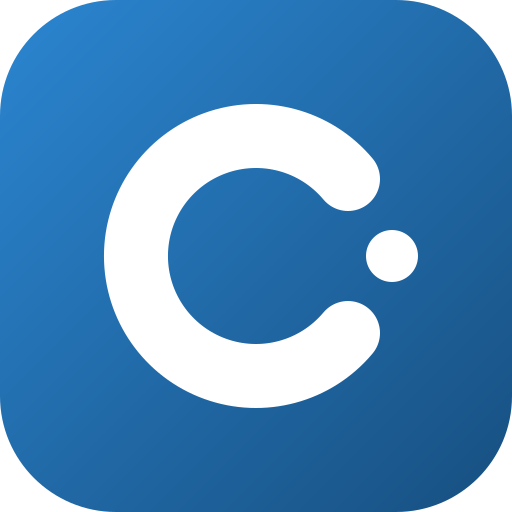

<p align="center">
  
</p>

<h1 align="center">Cosmo Control</h1>

<p align="center">
  Il gestionale personale di <a href="https://www.cosmonet.info">Cosmonet.info</a>:<br />
  articoli, Search Console, repository, memoria esterna e un connettore per Claude, in un'unica dashboard.
</p>

<p align="center">
  
  
  
  
  
</p>

---

## Cos'è

Cosmo Control raccoglie in un posto solo tutto ciò che serve per far crescere un blog con 1.600+ articoli:
cosa va rivisto, cosa sta calando, cosa Google non ha indicizzato, cosa è in coda.
Lo stile è pulito e clinico, pensato per essere letto in fretta.

L'app è **solo per uso personale** e **solo da desktop**. Senza chiavi funziona comunque, con dati di esempio
e un avviso giallo.

## Cosa fa

| Pagina | A cosa serve |
|---|---|
| **Panoramica** | Click di Search Console, KPI e gli articoli che richiedono attenzione, ordinati per potenziale. |
| **Sito** | Tutti gli articoli di WordPress con click, impressioni, CTR, posizione e *Potenziale*. Filtri, ordinamento, pulsante «✓ Rivisto» ed **Esporta CSV**. |
| **Scheda articolo** | Andamento giornaliero, ricerche reali che portano all'articolo, stato per Google, link per modificarlo su WordPress. |
| **Repository** | Le repository GitHub con linguaggio, ultimo push e issue aperte. |
| **Grafici** | Click e impressioni al giorno, resa per categoria, articoli migliori. |
| **Avvisi** | Articoli in calo e in crescita (28 giorni contro i 28 precedenti) e ricerche per cui due tuoi articoli si fanno concorrenza. |
| **Indicizzazione** | Stato di indicizzazione degli ultimi articoli secondo Google e salute delle sitemap. |
| **Coda** | Articoli programmati, bozze, prossimi 14 giorni con i giorni vuoti e ritmo di pubblicazione. |
| **Cosmo Memo** | La memoria esterna in sola lettura: progetti (collegati alla loro repository), attività, modifiche recenti. |
| **Canali** | Iscritti di Discord e Telegram. |
| **Impostazioni** | Stato di ogni collegamento e regole di revisione. |

### La regola di revisione

Un articolo pubblicato va rivisto se **non è stato toccato da più di `REVIEW_DAYS` giorni** (default 90).
La data di «ultimo intervento» è la più recente tra pubblicazione, ultima modifica vera e revisione segnata qui.
Le modifiche in blocco (più di 50 articoli con la stessa data di modifica, di solito un aggiornamento di plugin o tema)
vengono ignorate, e l'elenco dei giorni scartati è visibile in fondo alla pagina Sito.

**Potenziale** = impressioni × (1 − CTR), ×1,5 se l'articolo è in posizione 5–20. Più è alto, più conviene rivederlo.
Le ricerche "navigazionali" (il solo nome di un servizio) lo gonfiano.

### Storico di Search Console

Google conserva circa 16 mesi di dati. Un cron giornaliero salva su Supabase i dati per pagina e per giorno
(`gsc_page_daily`), così la scheda articolo può mostrare andamenti oltre i 90 giorni.

### Connettore per Claude (MCP)

L'app espone un server MCP su `/api/mcp/<MCP_TOKEN>` (JSON-RPC su HTTP, senza stato).
Strumenti: `get_overview`, `list_articles`, `articles_to_review`, `get_article` (testo + ricerche reali da Search Console)
e `mark_reviewed`. **Non modifica WordPress**: le modifiche le propone Claude e le applica un connettore separato.

## Come è fatto

- **Next.js 14** (App Router), **TypeScript**, **Tailwind** con variabili CSS in `app/tokens.css`.
- Nessun database proprio: WordPress (REST), Search Console, GitHub e Cosmo Memo si leggono dal vivo;
  le revisioni e lo storico stanno su **Supabase** (accesso REST, chiave segreta solo lato server).
- Protezione con password (HTTP Basic) tramite `middleware.ts`. MCP e cron si proteggono da soli con un token.
- Pagine dinamiche, caricamento a più richieste in parallelo e `loading.tsx` per le attese lunghe.

```
app/            pagine e route API (mcp, cron, export)
components/     barra laterale, grafici, elementi comuni
lib/            WordPress, Search Console, GitHub, Supabase, Cosmo Memo, canali
supabase/       schema.sql con le tabelle
docs/           brief per il lato Cosmo Memo
```

## Avvio in locale

```bash
npm install
cp .env.example .env.local   # poi compila i valori
npm run dev
```

Poi apri <http://localhost:3000>. Per controllare il codice: `npm run lint` e `npx tsc --noEmit`.

## Installazione

1. **Supabase**: crea un progetto, apri lo SQL Editor e incolla `supabase/schema.sql` (tabelle `article_reviews` e `gsc_page_daily`).
2. **Vercel**: importa il repository e imposta le variabili qui sotto **prima** del deploy: il middleware legge
   `APP_PASSWORD` in fase di build.
3. **Search Console**: crea un account di servizio Google, abilita la Search Console API e aggiungi la sua email
   alla proprietà del sito (permesso *Completo* o *Limitato*).
4. **Cron**: `vercel.json` programma ogni giorno alle 5:00 il salvataggio dello storico. Per recuperare i mesi passati,
   una volta sola:

   ```bash
   curl -H "Authorization: Bearer $CRON_SECRET" \
     "https://<tuo-dominio>/api/cron/gsc-snapshot?days=90"
   ```

   Per periodi più vecchi usa `?from=AAAA-MM-GG&to=AAAA-MM-GG`, a blocchi di circa tre mesi.

## Variabili d'ambiente

Copia `.env.example` come punto di partenza. **Non committare mai `.env.local` né le chiavi segrete.**

| Variabile | Obbligatoria | Per cosa |
|---|---|---|
| `APP_PASSWORD` | sì, in produzione | Password di accesso (qualsiasi nome utente) |
| `WP_BASE_URL`, `WP_USER`, `WP_APP_PASSWORD` | sì | WordPress con Application Password |
| `GSC_SERVICE_ACCOUNT_JSON`, `GSC_SITE` | consigliate | Search Console (JSON dell'account di servizio, es. `sc-domain:cosmonet.info`) |
| `SUPABASE_URL`, `SUPABASE_SECRET_KEY` | consigliate | Revisioni e storico |
| `CRON_SECRET` | per lo storico | Protegge `/api/cron/gsc-snapshot`; Vercel lo invia da solo al cron |
| `MCP_TOKEN` | per Claude | Stringa casuale lunga, parte dell'indirizzo MCP |
| `GITHUB_USER` / `GITHUB_TOKEN` | facoltative | Repository (il token mostra anche le private) |
| `COSMOMEMO_URL`, `COSMOMEMO_READ_TOKEN` | facoltative | Cosmo Memo in sola lettura |
| `DISCORD_INVITE` | facoltativa | Codice dell'invito pubblico, per gli iscritti |
| `TELEGRAM_BOT_TOKEN`, `TELEGRAM_CHAT_ID` | facoltative | Iscritti del canale Telegram |
| `REVIEW_DAYS` | facoltativa | Soglia di revisione in giorni (default 90) |

Per generare un token casuale:

```bash
openssl rand -base64 32 | tr '+/' '-_' | tr -d '=\n'; echo
```

Dopo ogni cambio di variabili serve un nuovo deploy. La pagina **Impostazioni** mostra quali collegamenti sono attivi.

## Sicurezza

- Tutto il codice che usa chiavi gira **solo lato server**; nessuna variabile ha il prefisso `NEXT_PUBLIC_`.
- Le tabelle Supabase hanno RLS attiva e nessuna policy: la chiave pubblica non vede nulla.
- I confronti di token usano `timingSafeEqual`.
- Il server MCP è di sola lettura su WordPress: nessuna modifica agli articoli passa da qui.

## Stile

Tutti i colori sono in `app/tokens.css`. L'icona (`app/icon.svg`) è una «C» con un satellite, nello stesso blu del logo.

## Licenza

Progetto personale di [Daniele Spalletti](https://www.cosmonet.info) (CosmoNetinfo). Tutti i diritti riservati.
